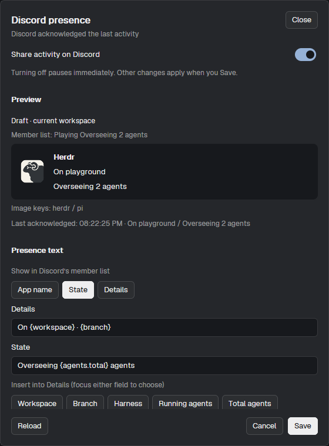

# Discord Presence

Share the selected Herdr workspace, its focused terminal’s branch, harness, and app-wide agent counts as a Discord Playing activity named **Herdr**. A tab-owned native mod pane keeps hosting across tab and layout switches after it is first shown. A dependency-free Windows Node helper handles Discord IPC. No OS login task or startup launcher is used. The screenshot shows a configured installation, not the default text.



## What you see

- One host pane added beside existing terminals with `pane.split`, using `{"mod":"discord-rpc","props":{"presenceHost":true}}`. It belongs to its tab, not to the active layout definition. After first initialization, resize it to `px: 0` for an invisible host without taking terminal space. Keep it present with `hidden` unset/false; resize it wider temporarily to use its host controls. Preserve existing terminals and keep the host pane open while sharing.
- Optional launcher: an 18px monochrome Discord mark in a 40px-wide block alongside a 28px status bar, with theme colors, hover feedback, and a “Discord presence” tooltip.
- Settings: a 560×760 native dialog with 18px padding, fixed title/status header and Reload / Cancel / Save footer, and a scrolling middle. Title is 16px semibold, body 13px, notes 12px with 18px line height.
- A sharing switch warns that pausing is immediate. Preview shows draft/current-workspace text, the member-list selection, expanded Details/State, local reference artwork, and asset-key labels. Connection state and last acknowledged activity/time are separate from the draft.
- Text controls select App name / State / Details for the member list, edit two templates, insert five supported variables at the last focused cursor/selection, and reset defaults.
- Privacy edits workspace globs. Appearance controls artwork and harness icon. Advanced exposes application ID and artwork key.
- Use Herdr’s UI font and theme colors. Inputs/buttons use native focus handles and accessible labels; the dialog must scroll rather than push Save offscreen. No browser APIs, terminal scraping, or animated per-agent badges.

## How it behaves

- A selected workspace produces activity; no workspace produces none. Native `focused()` identifies the focused terminal or `shown` borrowed-terminal replacement. Branch comes from its pane metadata or a Git lookup at its live cwd on its machine, cached for ten seconds per unchanged context. Non-Git terminals omit branch rather than borrowing another pane’s branch.
- Count live top-level reporting agents across connected spaces. Working increments running and total; blocked, done and idle increment only total. Shells, finished terminals and sub-agents do not count. Harness follows the focused reporting agent, otherwise the selected workspace’s unique root harnesses joined with “ + ”. Recognize Pi, Claude Code, Codex, Gemini, OpenCode, Cursor and GitHub Copilot without guessing models.
- Privacy matches whole workspace names, case-insensitively, with `*`/`?` wildcards. Private selected or borrowed-terminal owner spaces become “Private workspace” and omit branch in both text lines. Counts and harness remain visible. Publication and preview share native focus data and privacy mapping.
- Default Details is `{workspace} · {branch}`; default State is `{harness} · {agents.running}/{agents.total} agents active`. Apply privacy before substitution. Empty variables remove adjacent template separators, never punctuation within values. Blank templates omit optional lines; empty selected member-list text falls back to Herdr. Literal template text is not privacy-filtered.
- Preview changes immediately; Save applies drafts together. Cancel, Close and Escape discard drafts. Pausing is the exception: persist the saved configuration with sharing disabled immediately, even if the dialog is later canceled. Turning sharing back on requires Save.
- Reload rereads configuration. Save validates, preserves unknown fields, refuses concurrent external edits, and closes on success. Conflicts keep the draft with Reload guidance. Missing config offers shared defaults; malformed config shows an error rather than editable defaults.
- Opening/closing settings overlays and optional launchers never starts another host or clears activity. Settings has a Create RPC pane action: split the focused tab pane with explicit host props, resize the new pane to zero width, and restore original pane focus without saving/discarding drafts. If a discord-rpc pane already exists, select it instead of creating a duplicate; disable repeat clicks while creating and report command failures without losing drafts. The bundled global Ctrl+Alt+D binding opens settings in any layout after merging it into existing keys. Preserve unrelated bindings and ask before replacing a conflict; Ctrl+Alt may conflict with AltGr.
- A loaded host pane survives tab/layout switches and polls fresh native state while zero-width or in an inactive tab. Zero width does not remove it from Herdr’s visible-pane scan. Do not use `layout.hide` or `hidden: true`, which prevents initialization after a restart until the pane is shown again. An inactive restored pane does not initialize until its tab is shown; do not promise app-wide automatic startup. Closing the host pane attempts an immediate clear. Closing Herdr stops the host; heartbeat expiry is the fallback for incomplete cleanup.
- Non-null Discord updates coalesce and are throttled to one per 15 seconds. The bridge checks config independently, so pause clears without that throttle. It reconnects after Discord disconnects. Invalid configuration fails closed.

## Built from

Ship `mods/discord-rpc/`, `scripts/install-windows.ps1`, `keys.json`, documentation and `preview.png`. Do not ship personal `config.json`, runtime state, or layouts. Bundle `keys.json` with `{"global":{"ctrl-alt-d":"mod.open:discord-rpc"}}`, merging rather than replacing existing keys.

### Files

- `main.js`: native `View` with an explicit `{presenceHost:true}` pane role, overlay settings, or `{launcher:true}`. Legacy no-props layout blocks remain inert. Only the host has heartbeat/start/clear lifecycle. `mod.json` uses `place: "none"` and a 560×760 settings overlay.
- `settings.js`: native draft UI with distinct persisted source, error/busy state, preview, and last-focused template input. Release replaced input states; use fresh callback contexts rather than retaining `cx`.
- `presence.js`: pure config validation, glob matching, templates, privacy, and data-to-activity mapping shared by host and preview.
- `bridge.mjs`: Discord IPC framing, READY handshake, nonce-correlated `SET_ACTIVITY`, reconnect/throttle/clear behavior, singleton startup and acknowledged status.
- `scripts/install-windows.ps1`: copies mod/helper files while preserving existing config, creates defaults only if missing, and prints the manual host-pane command. It never creates panes, login tasks or startup launchers, and does not modify existing Scheduler tasks. Run from the repository root with `pwsh -NoProfile -ExecutionPolicy Bypass -File ./scripts/install-windows.ps1`.
- `discord.svg`: Simple Icons Discord mark (CC0). Default preview artwork uses Herdr’s local `frame/welcome/herdr.png`; asset labels are not fetched Discord artwork.
- `config.example.json`: shared public application ID `1529832902387302510`, sharing enabled, default templates, `herdr` large image and harness icon. The installed local config remains the source of user preferences.

### Herdr integration

Initialize hosting only for `props().presenceHost === true`, after checking overlay/launcher roles. Use `agents()`, `spaces()`, `terminals()`, `panes()` and `focused()` directly, not the external CLI collector. Serialize concurrent flushes; native rerenders mark revisions and a one-second timer refreshes activity/heartbeat at least every ten seconds. Timer refreshes must read fresh native state even if the host is zero-width or its tab is inactive and no render occurred. Use cached `exec("git", ["branch", "--show-current"], {cwd, on})` for missing branch metadata.

Write `.presence.json` (`version:1`, millisecond `updatedAt`, sanitized `activity`) and `.status.json` (bridge state, pid, lastAckAt, acknowledged activity, error, updatedAt), including atomic temporary files, under `<appHome>/data/discord-rpc/`, never the watched mod folder. Use Herdr compare-and-write file APIs for host snapshots. On invalid configuration, write null activity. After snapshot writes, ensure the helper through `exec("node", [bridgePath, "--start", modDirectory])`. The bridge reads snapshot/config independently each second. Settings polls runtime state and uses the same native mapping for preview.

Create the host in an existing tab with:

```powershell
herdr-app do pane.split '{"direction":"right","mod":"discord-rpc","props":{"presenceHost":true}}'
```

For invisible operation, initialize the new pane and then run `herdr-app do layout.resize '{"id":"<RPC_PANE_ID>","px":0}'`, substituting the RPC pane’s ID. Do not resize an existing terminal by mistake. Keep `hidden` unset/false: this preserves startup initialization when the pane’s tab is selected, unlike `layout.hide` or `hidden: true`.

No layout definitions need editing. Keep one host pane per app home; multiple panes/windows competing over one snapshot are unsupported. Optional launchers may use `{"mod":"discord-rpc","props":{"launcher":true}}` in personal layouts; do not modify shipped layouts. `herdr-app do mod.open --name discord-rpc` opens settings without starting a host.

### Discord transport and lifecycle

Run on the same Windows desktop as Discord. Probe named pipes `\\.\pipe\discord-ipc-0` through `9`, send a version-1 client-ID handshake, await READY, and send nonce-correlated `SET_ACTIVITY` with the helper PID. Use an 8-byte little-endian opcode/length header followed by JSON. Handle split/combined frames, PING/PONG, errors, disconnects, five-second READY/ACK timeouts, and a 1 MiB frame limit. Record publication only after acknowledgment. Reconnect every five seconds while retaining the latest desired activity.

Allow an immediate null clear even with a non-null operation pending; late acknowledgments must not restore stale status. Reject snapshot heartbeats older than 45 seconds or more than five seconds in the future. Lease expiry clears and exits the helper. Atomic status writes retry transient Windows rename locks. Bound graceful shutdown clearing to one second. The pane’s close path attempts to write null activity with compare-and-write retries; no standalone collector remains alive after Herdr closes.

## Watch out

- Workspace and branch names are public on Discord. No raw paths, titles, prompts, commands or machine names are published, and no bot/user token or web server is used.
- Require Windows Node.js 20+, PowerShell 7 for installation, a compatible running Herdr, and desktop Discord with activity sharing enabled. macOS/Linux transport support is deferred and untested; see `BACKLOG.md`.
- An inactive saved host pane is not an app startup hook. Show its tab once per Herdr launch. Tab/layout switching after initialization must not stop the host.
- Migrating from the standalone service requires stopping/removing its verified owned Scheduler task and ensuring its collector exited before starting the pane host. The installer does not do that automatically. Never stop unrelated processes or restart the user’s Herdr core.
- A running Node helper retains its loaded JavaScript during upgrades. Close the old host and wait for the last heartbeat lease to expire before installing and starting a new host. Preserve config.
- Never write runtime state under `mods/`: even hidden-file directory notifications can trigger hot reloads.
- Validate client ID as a 17–20 digit string; booleans as booleans; privacy patterns as strings; artwork key as nonblank text up to 128 characters; display type as `name`, `state`, or `details`. Templates support only the five documented variables and at most 512 characters. Reject malformed braces. Sanitize controls, cap rendered lines at 128 Unicode codepoints and branch at 48, and prefix one-character results with `In `.
- The preview is not evidence of publication. IPC acknowledgment is not visual verification of Discord’s profile. Preserve privacy before substitution and do not hard-code secrets into literal templates.

## Done when

- Automated tests pass on local and Windows Node, covering host-only lifecycle, hidden-pane timer refresh, privacy, templates, root counts, branch cache/fallback, compare-and-write retries, and settings/legacy-layout isolation.
- The file-copy installer is idempotent, preserves config/unknown files, and invokes no Scheduler operations or startup launcher.
- `herdr-app check <appHome>/mods/discord-rpc` passes and host/settings/launcher show no `herdr-app status` errors.
- Workspace/pane and agent-status changes update sanitized snapshots. Disabled/invalid config or no workspace clears activity. Closing the host clears immediately or through lease expiry.
- Switching tabs/layouts leaves presence updating. Opening/closing settings does not start or clear the host. Pause clears and resume/save republishes.
- IPC tests cover framing, timeouts, errors, reconnect, throttle/coalescing, immediate clear, stale/future heartbeat, singleton and cleanup. Runtime/temp files remain outside watched mods.
- With Discord running, status records acknowledged activity matching intended text. Inspect Discord separately before claiming its profile UI was verified. Do not claim checks that were not run.
